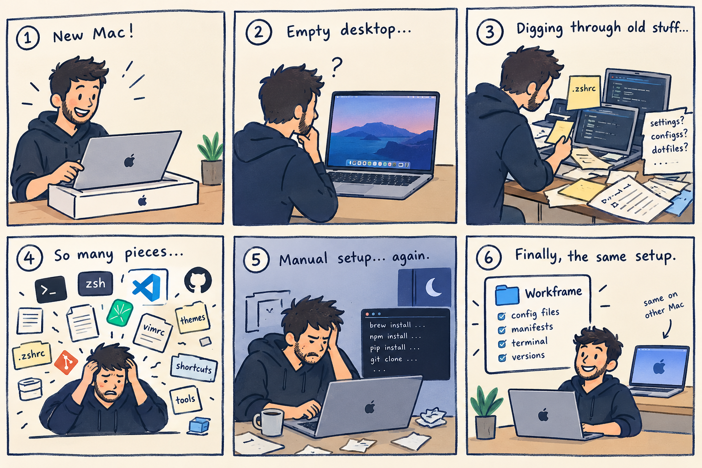

# Workframe

[](https://github.com/lc-rezende/Workframe/actions/workflows/validate.yml)
[](https://buymeacoffee.com/lrezende)

> Version your Mac workspace once. Reproduce it anywhere.

## Every new Mac starts with the same scavenger hunt

The new machine is ready. Your workspace is not. You remember the shell prompt you tuned just right, the editor settings that make you faster, the terminal shortcuts you use without thinking, and the small tools that quietly hold your day together. But they are scattered across an old Mac, half-remembered commands, and configuration folders you have not opened in months.

So the rebuild begins: install a tool, search for a setting, copy a file, notice something missing, and repeat. A new user account turns into the same exercise. The setup works eventually, but it is never quite the setup you meant to keep.



Workframe gives the portable parts of your macOS workspace one version-controlled home. Keep your configuration, dependency requirements, and reusable repository references together, then safely reproduce them on a new Mac or user account.

This template deliberately does not include personal configuration. Create a private repository from it, then manually add your own files. The bootstrap does not move or edit a managed source. It validates every link before making changes and handles an existing destination only with an explicit choice during an interactive link run.

## Repository layout

| Path | Purpose |
| --- | --- |
| `managed/` | The required source root for files and directories managed by Workframe. |
| `manifests/links.conf` | Explicit mapping from a `managed/` source to an absolute local destination. |
| `manifests/dependencies.conf` | Tools and applications to validate and document. |
| `manifests/repositories.conf` | Reusable repositories to clone into `~/workspace`. |
| `scripts/bootstrap.sh` | Safe validation, linking, and repository-cloning entry point. |

## Prerequisites

- macOS
- Bash
- Git

Homebrew is optional. The template validates Git only by default; add your own optional tools to the dependency manifest.

## Add a configuration item

1. Manually copy or create the configuration anywhere below `managed/`.
2. Add one pipe-separated row to `manifests/links.conf`:

   ```text
   managed/starship/starship.toml | /Users/your-user/.config/starship.toml
   ```

3. Run `./scripts/bootstrap.sh --link`.

The first field must be a repository-relative path beginning with `managed/`. The second field must be an absolute destination path. Parent-directory traversal is rejected in both fields.

## Commands

```sh
./scripts/bootstrap.sh --check
./scripts/bootstrap.sh --link
./scripts/bootstrap.sh --repos
```

- `--check` is read-only. It validates macOS, Git, Homebrew, and declared dependencies.
- `--link` creates destination symlinks from `managed/` sources and accepts an already-correct link without changing it. It validates the complete manifest before changing anything, then interactively resolves each existing destination before making changes.
- `--repos` clones only missing repositories from `manifests/repositories.conf` into `~/workspace`. It does not fetch, pull, reset, or otherwise change an existing directory or repository.

Run one action at a time. Use `--help` to print the command reference.

## Dependency manifest

`manifests/dependencies.conf` has four pipe-separated fields:

```text
kind | name | check | installation_hint
```

- `cli`: `check` is an executable name resolved with `command -v`.
- `app`: `check` is an application bundle path, normally below `/Applications`.
- `manual`: reported as informational because no reliable local check is defined; set `check` to `-`.

The manifest is intentionally not an installer. It gives each machine a reproducible requirements list without changing its package state.

## Optional tool examples

Add only the tools you use. For example:

```text
# manifests/dependencies.conf
cli | starship | starship | brew install starship
cli | herdr | herdr | brew install herdr
app | Visual Studio Code | /Applications/Visual Studio Code.app | brew install --cask visual-studio-code
app | iTerm | /Applications/iTerm.app | brew install --cask iterm2
```

```text
# manifests/links.conf
managed/starship/starship.toml | /Users/your-user/.config/starship.toml
managed/herdr/config.toml | /Users/your-user/.config/herdr/config.toml
```

The sources in those examples must be manually added to this repository before running `--link`.

## External repositories

`manifests/repositories.conf` has three pipe-separated fields:

```text
name | url | destination_relative_to_workspace
```

For example:

```text
ai-resources | git@github.com:example/ai-resources.git | ai-resources
```

External repositories remain independent Git repositories. This workspace repository does not use submodules and does not duplicate their contents.

## Safety and secrets

- Never commit API keys, tokens, private keys, credentials, or machine-specific secrets.
- Put local-only values in ignored files such as `.env`, `.env.<resource>`, or `.workspace-local/`.
- Commit safe templates for those files as `.env.example` or `.env.<resource>.example`; leave secrets and real values out of every template.
- For every existing destination, an interactive link run requires an explicit choice to abort, back it up in place, or override it. A backup is named beside the original as `<name>.<timestamp>.bak`. A non-interactive run aborts safely without modifying anything.
- Review `git status` before committing configuration changes.

## Create your private workspace

Use GitHub's **Use this template** action to create a private repository. Keep personal dotfiles, private repository references, and real environment values only in that private repository. The public template should contain only generic tooling, documentation, and safe examples.

To adopt public-template improvements later, add this repository as an `upstream` remote in your private repository and merge or cherry-pick changes deliberately after reviewing them.

## Contributing

Contributions should improve the generic template without adding personal configuration, credentials, user-specific paths, or private repository URLs. Test the bootstrap commands and keep documentation in English before opening a pull request.

## Continuous integration

GitHub Actions runs the functional bootstrap test suite on macOS for every pull request and every push to `main`. The suite validates shell syntax, manifest parsing, safe link creation, idempotent links, explicit conflict handling, repository cloning, and existing-destination protection.

Run the same checks locally with:

```sh
bash tests/bootstrap_test.sh
```

## Extending the workspace

When adding a new tool, add its portable configuration manually below `managed/`, declare its absolute destination in `links.conf`, declare its validation/install hint in `dependencies.conf`, and document any tool-specific manual setup in this README or a dedicated English document.
